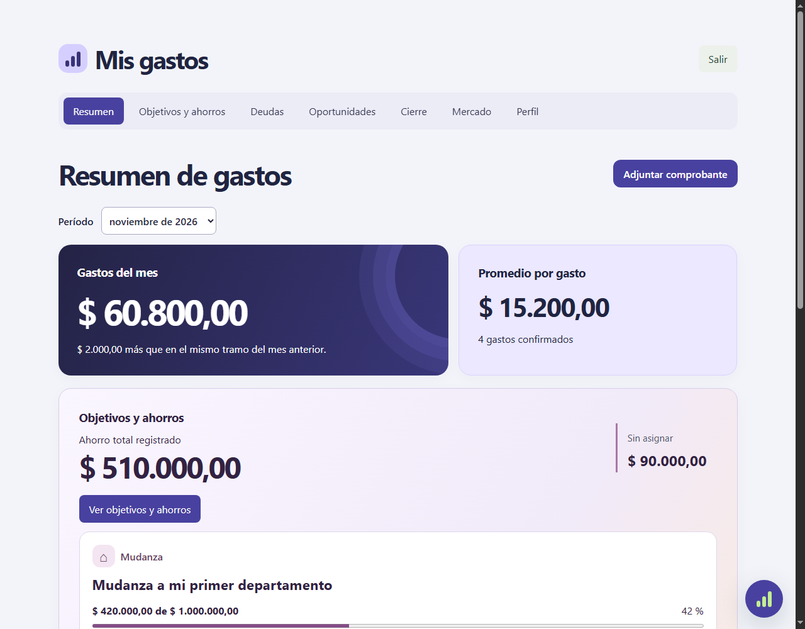
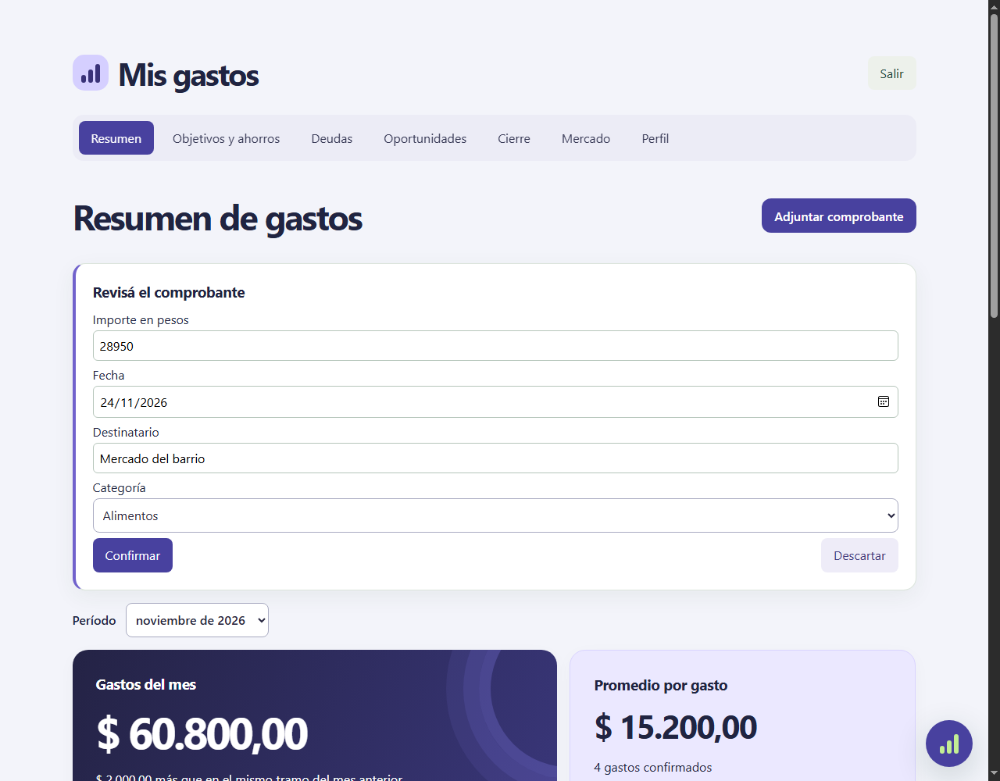
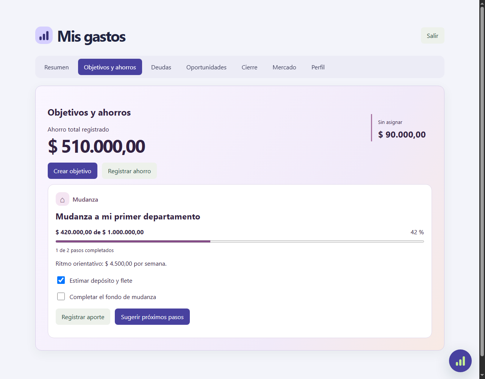
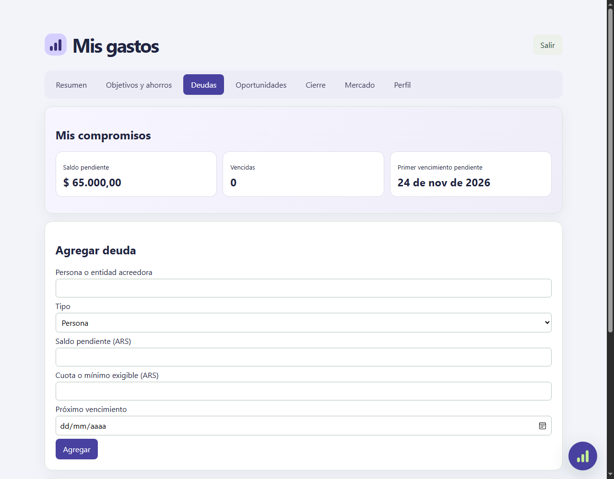

# Mis Gastos

Proyecto personal de desarrollo full stack para quienes pagan con el celular y quieren saber adónde se fue la plata. La persona comparte un comprobante, revisa los datos detectados y confirma el movimiento. El resumen mensual reúne esos gastos con sus objetivos de ahorro.

Las capturas muestran la interfaz del piloto con datos ficticios en pesos argentinos.

## Del comprobante al movimiento

Una transferencia por $28.950 queda pendiente de revisión. La persona puede corregir el importe, la fecha, el destinatario o la categoría antes de incorporarla al historial.

## Ahorrar para una mudanza

La meta combina un importe y pasos concretos. En el ejemplo ya se ahorraron $420.000 de $1.000.000 y se completó la estimación del depósito y el flete.

## Tener presentes los vencimientos

El módulo de deudas reúne el saldo pendiente, las obligaciones vencidas y la próxima fecha de pago. Al registrar una deuda se distingue el saldo total de la cuota exigible.

## Desarrollo

Construí el portal con React y JavaScript y el servicio con Node.js y SQLite. El flujo de comprobantes integra Tesseract.js para leer imágenes y Telegram Bot API para recibir archivos. El asistente consulta modelos mediante Ollama.

El componente de progreso ilustra cómo la interfaz representa tanto metas en pesos como objetivos medidos por pasos. [Ver muestra de React](interfaz/GoalProgress.js)
